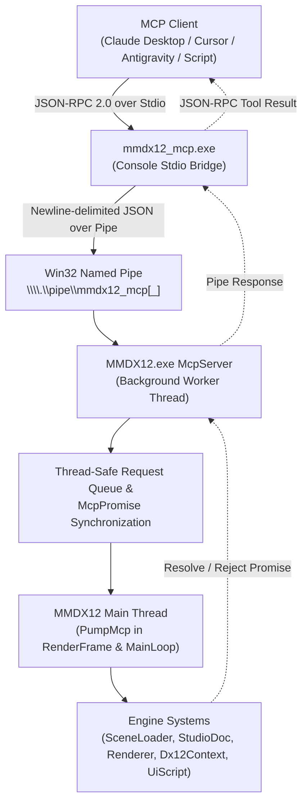

# Model Context Protocol (MCP) in MMDX12

MMDX12 supports interactive AI agent and tool automation via the [Model Context Protocol](https://modelcontextprotocol.io/) (protocol specification `2025-06-18`).

Agents running in Claude Desktop, Cursor, Antigravity, or custom automation scripts can inspect the active scene, query performance metrics, capture in-memory backbuffer screenshots, load songs and stages, edit poses and keyframes in Studio, trigger offline 4K / video renders, and simulate UI inputs.

---

## 1. Architecture



### Components
1. **Bridge (`mmdx12_mcp.exe`)**:
   - Lightweight console application that translates stdio JSON-RPC 2.0 protocol from the MCP host into Win32 named pipe transactions.
   - Manages connection lifecycle (`list_instances`, `connect`, `launch_app`).
   - Binary mode on stdin/stdout to prevent CRLF line ending corruption.
2. **Server (`MMDX12.exe` internal `McpServer`)**:
   - Listens on `\\.\pipe\mmdx12_mcp` (or `\\.\pipe\mmdx12_mcp_<pid>` if an instance is already listening).
   - Secured with an owner-only Win32 discretionary access control list (`D:(A;;GA;;;OW)`).
   - Overlapped asynchronous I/O with cancellation on app shutdown.
3. **Main Thread Pump (`App::PumpMcp`)**:
   - Drains requests synchronously during `RenderFrame()`, before UI and scene updates.
   - In minimized state, drained during `MainLoop()` to maintain responsiveness without burning GPU cycles.
   - Non-blocking multi-frame commands (`wait_frames`, `load_scene`, `ui_input`) suspend until target conditions are met.

---

## 2. Configuration & Setup

### Binary Path Guidelines
- **Portable Release (`dist/MMDX12-*.zip`)**: `mmdx12_mcp.exe` is located directly in the root folder alongside `MMDX12.exe` (e.g., `C:\MMDX12\mmdx12_mcp.exe`).
- **Development Build**: `mmdx12_mcp.exe` is located in the output bin directory (e.g., `C:\path\to\MMDX12\build\bin\mmdx12_mcp.exe`).

### Claude Code
```powershell
claude mcp add mmdx12 -- C:\path\to\MMDX12\mmdx12_mcp.exe --launch
```

### Claude Desktop
Add to your `%APPDATA%\Claude\claude_desktop_config.json`:

```json
{
  "mcpServers": {
    "mmdx12": {
      "command": "C:\\path\\to\\MMDX12\\mmdx12_mcp.exe",
      "args": ["--launch"]
    }
  }
}
```

### Cursor / Antigravity
Add to your project or user MCP settings:
```json
{
  "mcpServers": {
    "mmdx12": {
      "command": "C:/path/to/MMDX12/mmdx12_mcp.exe",
      "args": ["--launch"]
    }
  }
}
```

---

## 3. Command Line Arguments

### `mmdx12_mcp.exe`
- `--pipe <name>`: Explicit pipe path or name (e.g., `mmdx12_mcp` or `\\.\pipe\mmdx12_mcp_1234`). Default: auto-connect to `\\.\pipe\mmdx12_mcp` or single running instance.
- `--pid <pid>`: Target specific process ID (`\\.\pipe\mmdx12_mcp_<pid>`).
- `--launch`: If no running MMDX12 instance is found, automatically spawns `MMDX12.exe --mcp` from the same folder and waits up to 60 s for its pipe to answer (the pipe opens before the library scan; `get_state` reports `scanning` until it is done).
- `--timeout <ms>`: Minimum per-request timeout in milliseconds (default: 30000). Loads wait up to 180 s, `wait_frames` / `ui_input` up to 120 s; an answer that arrives after a timeout is discarded.

### `MMDX12.exe`
- `--mcp`: Force enables MCP named pipe server for this run (ignores persisted `.ini` setting). Automated runs (`--frames`, `--ui-script`, `--screen`, benchmarks, offline renders) only open the pipe with `--mcp`.
- `--no-mcp`: Force disables MCP named pipe server for this run.

---

## 4. User Interface Integration

- **Detail Settings Tab**: Toggle `Tr("MCP 제어")` ("MCP Control") enables or disables the background server dynamically without needing a restart. Persisted in `mmdx12.ini` as `mcp=1` or `mcp=0`.
- **Connected Indicator**: When an MCP client or bridge is actively connected to the pipe:
  - **Lobby App Bar**: An illuminated pill badge with CPU icon and `MCP` label appears next to the library folder button.
  - **Studio Top Bar**: An illuminated pill badge appears next to the Help button.
  - **Hover Tooltip**: Displays the active pipe name (e.g., `MCP 연결됨: \\.\pipe\mmdx12_mcp`).

---

## 5. Tool Catalog (35 Tools)

### Bridge & Connection Management
1. `list_instances`: Enumerates active MMDX12 named pipes on `\\.\pipe\mmdx12_mcp*`.
2. `connect`: Connects or switches to a target pipe name or process ID.
3. `launch_app`: Spawns `MMDX12.exe --mcp` and waits for connection.

### Application State & Diagnostics
4. `get_state`: Inspects current screen (`select`, `play`, `studio`, etc.), playback status, current model/stage/song names, FPS, GPU render time in milliseconds, render path, upscaler, and window dimensions.
5. `get_recent_logs`: Returns the last $N$ lines from the application log.
6. `list_library`: Lists available characters, stages, and songs with filtering (`kind`: `all|character|stage|song`, optional search `query`).

### Screen Control & Capture
7. `screenshot`: Reads back the Direct3D 12 backbuffer (scene + UI, no mouse cursor), or with `scene_only: true` the renderer's last finished frame without any UI (requires a play or studio scene). Inline: downscaled to `max_width` (default 1280, 0 = full size) and returned as an MCP image block plus a short text block (size, screen). With `path`: written there as a full-size PNG (folders are created; `max_width` still applies when given) and returned inline only with `return_image: true`. `region: [x, y, w, h]` crops first (window pixels).
8. `wait_frames`: Advances the simulation by $N$ frames before completing.
9. `set_screen`: Changes the active screen (`select`, `studio` = a new empty project, `shaders`, `bench`).

### Playback & Scene Loading
10. `load_scene`: Loads a character, stage, and song by name or substring into Play mode (returns when loaded). The lobby selection follows.
11. `open_studio`: Launches Studio with an empty project, a preloaded character/stage/song, or a `project` file.
12. `play`: Starts or resumes playback.
13. `pause`: Pauses playback.
14. `seek`: Jumps playback or the timeline cursor to `seconds` (clamped; the result gives the actual time).

### Graphics & Render Settings
15. `get_render_settings`: Queries active graphics preset, render path (`raster`, `rt`, `pt`), upscaler (`none`, `dlss`, `fsr`, `xess`), post-processing toggles (DoF, volumetric, bloom, LUT), and in play mode the character's `shader_pack` and `shader_texture_folder`.
16. `set_render_settings`: Updates render path, upscaler, quality preset, lighting preset, DoF / volumetric / FFT bloom, the loaded character's shader pack (`shader_pack`), the per-character pack texture folder (`shader_texture_folder`, empty string clears), or `effects` (the whole effect stack: comma-separated effect pack ids, `none` clears it). Every value is checked first: an invalid one fails the call and changes nothing. Saved to the settings like the lobby's controls; the answer is the settings now in effect.

### Studio Control & Inspection
17. `studio_get_state`: Full dump of Studio document state, playhead position, selection, camera mode, dirty flag, undo/redo stack, and list of models with keyframe counts.
18. `studio_command`: Executes any `--ui-script` command (`studiobone`, `studiogizmo`, `studiolight`, `studiostate`, ...). `studionew` / `studioopen` / `studiosave` go through `open_studio` / `studio_open` / `studio_save` (unsaved-changes guard, waits for the load).
19. `studio_save`: Saves the active project to `file` (required).
20. `studio_open`: Opens a `.mmdxproj` project file.
21. `studio_add_model`: Adds a model by `file` path or `library` name (`kind`: `character`, `stage`, `prop`); answers once the model is loaded (or with the load error).
22. `studio_select`: Selects a model by index (-1 for camera).
23. `studio_set_camera`: Without `key`: sets the free view (the viewport stops looking through the motion camera). With `key: true`: writes the motion camera key at the playhead (inserted first if missing) and views through it.
24. `studio_set_bone`: Edits a bone of the selected character like the inspector's bone fields (VMD-local `translate` / `rotate_deg`; an omitted channel keeps the motion's value), one undo step; `key: true` registers it (auto-key does that by itself).
25. `studio_key`: Keys the playhead: `selected` (the selected rows / bones), `all` (every bone of the selected character), `camera`, `lights`. Answers `changed` (whether an undo step was added).
26. `undo`: Performs an undo operation.
27. `redo`: Performs a redo operation.

### Offline Video & Still Rendering
28. `render_still`: Starts an offline GI still of the current frame (play mode or studio) to `output` (optional); returns once started, poll `render_status`. The app keeps running afterwards.
29. `render_video`: Starts a video render with optional resolution, renderer, FPS, bitrate, spp and `start`/`end` (each a number of seconds or an `HH:MM:SS` / `MM:SS` / `SS` timecode string; default: the whole song). The answer includes `range_start` / `range_end` in seconds. The run's offline overrides go back when it ends.
30. `render_status`: Queries current render progress (frames rendered, percentage, ETA).
31. `render_cancel`: Aborts an ongoing offline render.

Navigation tools (`set_screen`, `load_scene`, `open_studio`, `studio_open`) refuse to leave a studio project with unsaved
changes unless `discard_unsaved: true`, and refuse while the app is loading, rendering or benchmarking. A failed load stays on its error screen (`get_state` shows `load_error`); any navigation tool leaves it.
While the window is minimized, read-only queries answer as they are; every other tool restores the window first (it needs rendered frames).

### Studio analysis tools (read-only)
These five tools answer questions about the active studio project without changing the document, the undo history, the
playhead or the view. Frames are timeline frames at 30 fps; angles are degrees; bones are PMX names (Japanese).
- `studio_scene_info`: Snapshot of the project: fps/end frame/aspect, audio, per-model placement, key counts and world
  AABB, character height/center/facing (0 = facing -Z, toward the default MMD camera), camera pose and eye, every
  scene light with all fields. Example: `{"name": "studio_scene_info", "arguments": {}}`
- `studio_sample_motion`: World-space bone positions at sampled frames, posed like the viewport without physics.
  Example: `{"name": "studio_sample_motion", "arguments": {"model": 0, "bones": ["頭", "左手首"], "start": 0, "end": 300, "step": 10}}`
- `studio_motion_events`: Derived choreography facts per character (jumps, crouches, hand raises, turns, holds,
  travel, energy) plus formation order and crossovers with two or more characters.
  Example: `{"name": "studio_motion_events", "arguments": {"model": 0, "step": 2}}`
- `studio_frame_check`: Screen framing per frame from the motion camera or a camera override (bbox, on-screen fraction,
  head in frame, cut points, screen height, distance, facing, shot size).
  Example: `{"name": "studio_frame_check", "arguments": {"frames": [120, 240], "camera": {"target": [0, 10, 0], "yaw_deg": 0, "pitch_deg": 5, "dist": 40, "fov_deg": 30}}}`
- `studio_audio_analysis`: Tempo, beats, downbeats, beat energy, onsets and sections of the project's audio, all in
  timeline frames. Example: `{"name": "studio_audio_analysis", "arguments": {"start": 0, "end": 900}}`

### Bulk key tools (camera, lights, bones, morphs)

These six tools read and write whole key lists as JSON. Every write is exactly **one undo step** named `AI: <tool>`.
All conventions below matter: values are MMD angles/units, not radians.

**Curve JSON** (`"curve"` on a key = the easing *into* this key from the previous key, VMD semantics):
- preset name: `linear` (20,20,107,107), `ease_in_out` (64,0,64,127), `ease_in` (64,0,127,127),
  `ease_out` (0,0,64,127), `smooth` (42,0,86,127), `fast_start` (0,64,64,127), `slow_start` (64,0,107,64);
- `[x1,y1,x2,y2]` integers 0..127, applied to every parameter / channel;
- camera object per parameter `{x, y, z, rotation, distance, fov}`, bone object per channel `{x, y, z, rotation}`,
  each a preset name or `[4]`; missing ones are linear.
On read, curves come back in the object form (preset name when the bytes match exactly, else `[4]`). Absent `curve`
means `linear`. Camera mapping: `rotation.x = -pitch`, `rotation.y = yaw`, `rotation.z = roll` (radians internally),
`distance = -dist` (so `dist > 0` puts the eye in front of the target, like `studio_set_camera`).

- `studio_get_camera_keys` `{start?, end?}` → `keys` (`frame`, `target`, `yaw_deg`, `pitch_deg`, `roll_deg`, `dist`,
  `fov_deg`, `perspective`, `curve`, `eye`) plus `cuts` (frames f with keys at f and f+1, MMD's cut convention).
  Example: `{"name": "studio_get_camera_keys", "arguments": {"start": 0, "end": 600}}`
- `studio_set_camera_keys` `{keys, mode}`. `mode`: `merge` (default, upsert by frame), `replace_range` (delete keys in
  `[min frame, max frame]` of the supplied keys first), `replace_all`. A missing field takes what the existing track
  evaluates to at that frame (the default `CameraKf` when empty). `fov_deg` clamps to 1..125. Sets
  `useMotionCamera = true`. Max 20000 keys. A cut = two keys on adjacent frames (there is no cut flag).
  Example: `{"name": "studio_set_camera_keys", "arguments": {"mode": "replace_all", "keys": [{"frame": 0, "target": [0, 10, 0], "yaw_deg": 0, "pitch_deg": 5, "dist": 40, "fov_deg": 30, "curve": "smooth"}, {"frame": 300, "target": [0, 10, 0], "yaw_deg": 30, "pitch_deg": 3, "dist": 35, "fov_deg": 35}]}}`
- `studio_set_light` `{index? | create, props?, base?, keys?, mode?, delete?}`. `create` is `sun|point|spot|area|ambient`
  (optional `name`); at most one sun and one ambient. `props` are the non-keyed fields (`name`, `enabled`, `vmd_link`,
  `rim_strength`, `rim_color`, `aim_mode`, `target_model`, `target_part`, `sway_phase`, `sky_zenith`, `sky_horizon`,
  `ground_color`, `shadow`, `shadow_softness`, `shadow_density`, `shadow_color`, `falloff`, `affect_diffuse`,
  `affect_specular`, `viewport_visible`); `base` holds the keyable values (`position`, `aim`, `direction`, `color`,
  `intensity`, `range`, `cone_outer_deg`, `cone_inner_deg`, `size`); `keys` are `{frame, ...keyable}` with a missing
  value taken from `SampleLightValues` at that frame. `mode` applies to the keys only. `delete: true` removes it.
  Answers `index` and `uid`. Creation, property changes and key writes are one `LightsCommand` (one undo step).
  Example: `{"name": "studio_set_light", "arguments": {"create": "spot", "name": "Key spot", "props": {"aim_mode": "target", "target_model": -1}, "base": {"position": [0, 60, -20], "intensity": 2.5, "cone_outer_deg": 20, "cone_inner_deg": 12}, "keys": [{"frame": 0, "intensity": 0}, {"frame": 60, "intensity": 2.5, "curve": "ease_in"}]}}`
- `studio_get_bone_keys` `{model, bones?, start?, end?, morphs?}` → `bones` (`{name: [{frame, translate,
  rotate_deg, quat, curve}]}`) and, with `morphs: true`, `morphs` (`{name: [{frame, weight}]}`). `rotate_deg` is Euler
  XYZ degrees in `studio_set_bone`'s convention (`XMQuaternionRotationRollPitchYaw(x,y,z)`); `quat` is `[x,y,z,w]`.
  Default: every bone with keys. Output caps at 20000 keys with `truncated: true`.
  Example: `{"name": "studio_get_bone_keys", "arguments": {"model": 0, "bones": ["センター", "頭"], "start": 0, "end": 300, "morphs": true}}`
- `studio_set_bone_keys` `{model, bones, morphs?, mode}`. `bones`: `{name: [{frame, translate?, rotate_deg? | quat?,
  curve?}]}`; missing `translate` / rotation takes the bone's evaluated value at that frame (zero / identity with no
  keys). Values are VMD-local like `studio_set_bone`. `morphs`: `{name: [{frame, weight}]}`. Bones and morphs must
  exist in the PMX (unknown names rejected, listing them). `mode` applies per listed track. Bumps the model's motion
  version. One undo step over all tracks.
  Example: `{"name": "studio_set_bone_keys", "arguments": {"model": 0, "bones": {"センター": [{"frame": 0, "translate": [0, 0, 0]}, {"frame": 120, "translate": [0, 0, 8], "curve": "ease_in_out"}]}, "morphs": {"まばたき": [{"frame": 0, "weight": 0}, {"frame": 10, "weight": 1}]}}}`
- `studio_delete_keys` `{target, start, end, index?, model?, bones?, morphs?}`. `target`: `camera` | `light` (needs
  `index`) | `bone` / `morph` (needs `model`, optional name lists; default every track with keys). Deletes keys in
  `[start, end]`, one undo step.
  Example: `{"name": "studio_delete_keys", "arguments": {"target": "camera", "start": 0, "end": 30}}`

### Input Simulation & Lifetime
32. `ui_input`: Injects virtual UI mouse and keyboard events (`move`, `click`, `dblclick`, `down`, `up`, `wheel`, `key`, `text`, `mod`) the same commands as `--ui-script`. Events run one per frame unless they give `frame` (offset from now); clicks add their own press / release. Real mouse / keyboard input is ignored only while injected steps are pending.
34. `ui_items`: The widgets of the last frame: `label` (visible text), `id` (the language-independent ImGui id string, e.g. `##play`), `window`, `rect` `[x, y, w, h]`. `query` matches label or id (case-insensitive substring); Korean source text also matches its translation in the current UI language, so one script drives every language. Clipped widgets and widgets covered by another window (a modal, a popup) are left out unless `include_hidden`. Besides ImGui items it lists drawn-only elements: timeline row headers (`##tlrow`) and visible keys (`##tlkey:<row>:<frame>`); shader pack cards carry `p:<id>:...` / `r:<id>:<version>`.
35. `ui_click`: Clicks (or `dblclick`, `right`, `hover`) the widget `target` found like `ui_items`' query (exact matches win over substrings; several matches need `index` or `window`). Answers once the click is delivered, with the widget's rect. `offset: [fx, fy]` picks a point inside the rect.
33. `quit_app`: Requests clean application shutdown.

---

## 6. Smoke Testing

Run the included standalone Python test script (requires only Python standard library):

```powershell
# Validate protocol handshake, capabilities, and all 33 tool schemas without running MMDX12:
python tools/mcp_smoke.py --handshake-only

# Drive the app over its named pipe without the bridge (tools/mcp_pipe.py; mcp_x.py runs short command lists):
python tools/mcp_x.py "click 플레이" "wait 30" "shot out.png" "items 셰이더"

# Run full end-to-end scenario (launches app, inspects state, loads scene, captures PNG, tests studio, exits cleanly):
python tools/mcp_smoke.py --scenario
```

---

## 7. Agent Context & Best Practices (For AI Agents)

When an AI agent interacts with MMDX12 over MCP, following these domain rules ensures reliable operation:

### 1. Zero Shipped Assets & Cold Library Scan
- MMDX12 ships **no copyrighted assets** by default. Assets reside under `library/characters`, `library/stages`, and `library/songs`.
- On the first run with new assets, MMDX12 performs a cold library scan that can take 20–25 seconds.
- **Agent Action**: Always run `list_library` first to check available assets, and inspect `get_state` (ensure it is not in `scanning` or `load_error` state) before attempting `load_scene` or `open_studio`.

### 2. Screen State Machine
- Application states: `select` (lobby), `play` (music video playback), `studio` (timeline & keyframe editor), and `bench` (benchmark).
- `studio_*` tools (`studio_set_bone`, `studio_add_model`, `studio_key`, etc.) only function when in `studio` screen. Use `open_studio` or `set_screen` with `screen: "studio"` first.
- Navigation tools (`set_screen`, `load_scene`, `open_studio`) guard against losing unsaved studio work (`discard_unsaved: true` is required if dirty).

### 3. Multi-Part Songs (Formations)
- Songs with >= 2 dance parts will open the formation selection modal in the lobby.
- **Agent Action**: Prefer 1-part solo dance songs for automated play tests, or inspect UI items (`ui_items`) and confirm the formation using `ui_click` if multi-part songs are loaded.

### 4. Asynchronous Loading & Frame Synchronization
- Scene loading, screen switching, and project loads happen asynchronously across frames.
- **Agent Action**: After triggering a state change (`load_scene`, `open_studio`, `seek`), call `wait_frames` (e.g. `n: 30` to `60`) to allow Direct3D 12 assets to load and temporal anti-aliasing (TAA) to settle before taking a `screenshot`.

### 5. Deterministic Visual Verification
- To compare visual rendering (A/B comparisons or regression checks):
  1. Call `pause` to halt playback.
  2. Call `seek` to jump to a specific timestamp.
  3. Call `wait_frames` (e.g. `n: 60`) so physics and TAA converge.
  4. Call `screenshot` with `scene_only: true` to get the clean 3D viewport without UI overlays.

